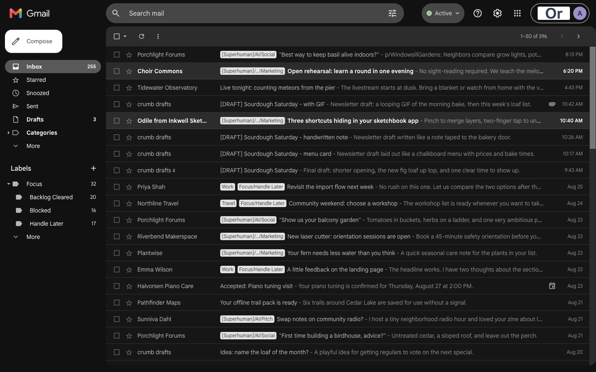
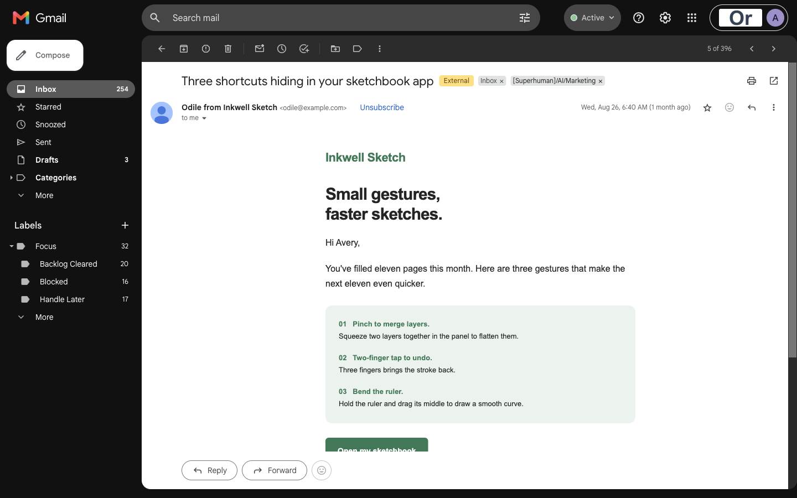
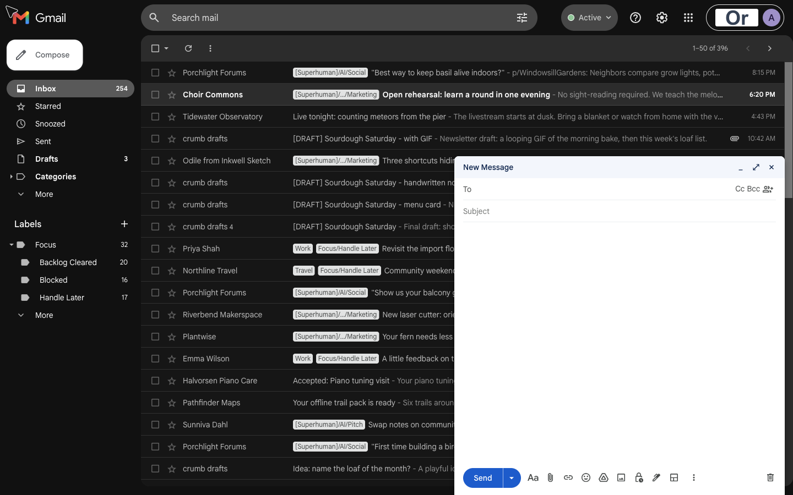

# Gmail

A recreation of the Gmail web UI in dark mode, built with React, Vite and TypeScript and running on fully synthetic local demo data. Messages, people, organizations, and attachments are fictional, including those shown below.

## Run

With Node.js 24+ and Bun installed, run from the repository root:

```sh
cd gmail
bun install
bun run dev
```

Open http://127.0.0.1:5174. No Google sign-in or backend is needed.

## Make it your own

- **Layout and screens:** [`src/App.tsx`](src/App.tsx) connects the views. Start with [`Header.tsx`](src/components/Header.tsx), [`Sidebar.tsx`](src/components/Sidebar.tsx), [`MailList.tsx`](src/components/MailList.tsx), [`MessageView.tsx`](src/components/MessageView.tsx), and [`Composer.tsx`](src/components/Composer.tsx) in `src/components/`.
- **Appearance:** edit [`src/styles.css`](src/styles.css) for shared variables and base styles, plus the CSS files in [`src/components/`](src/components/) for individual screens.
- **Demo content and actions:** [`src/data.ts`](src/data.ts) exports `initialEmails` and `initialLabels`; [`src/types.ts`](src/types.ts) defines their shapes. Local mail actions live in [`src/mailbox.ts`](src/mailbox.ts) and are wired up in `App.tsx`.

Copy this entire folder to start your own app, then install its dependencies. Use a fresh browser profile to see seed-data edits instead of previously saved demo state. See the [shared customization guide](../README.md#build-your-own-ui) for the workflow and backend integration.

Run `bun test` to check the mail logic, `bun run build` to produce `dist/`, and `bun run preview` to inspect the build locally.

## Screenshots

### Inbox



### Thread



### Compose


