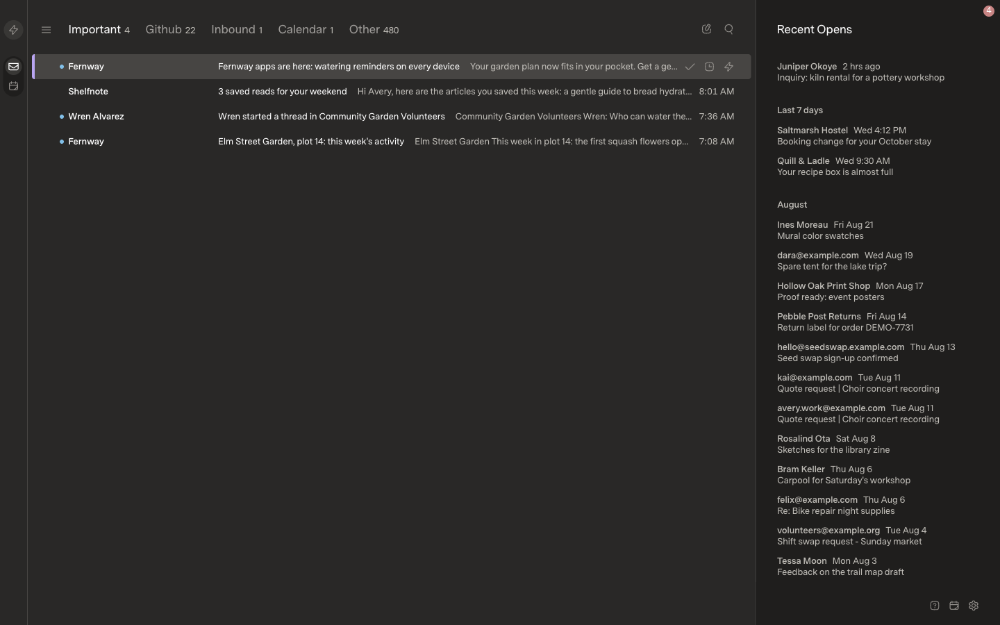
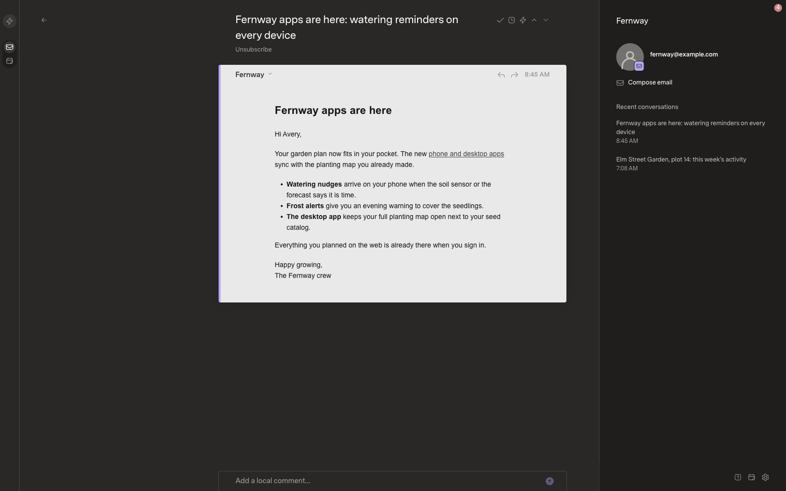
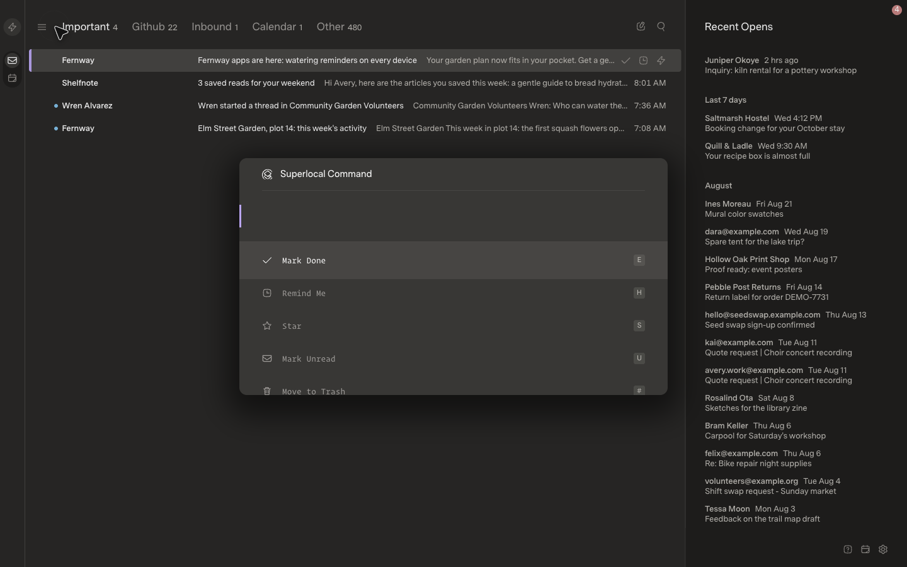
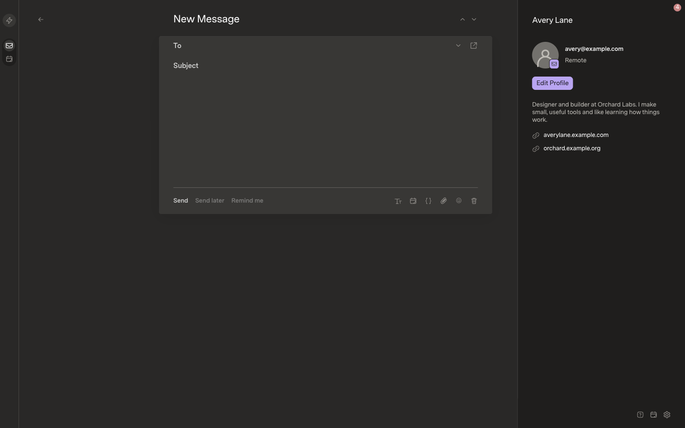

# Superhuman

A recreation of the Superhuman mail client UI, built with React, Vite and TypeScript and running on fully synthetic local demo data. Messages, people, organizations, and attachments are fictional, including those shown below.

## Run

With Node.js 24+ and npm installed, run from the repository root:

```sh
cd superhuman
npm ci
npm run dev
```

Open http://127.0.0.1:5178. No mail account or backend is needed.

## Make it your own

- **Layout and screens:** [`src/App.tsx`](src/App.tsx) connects the views. Start with [`MailRows.tsx`](src/MailRows.tsx), [`ThreadView.tsx`](src/ThreadView.tsx), [`Composer.tsx`](src/Composer.tsx), and [`MailCommandDialog.tsx`](src/MailCommandDialog.tsx) in `src/`.
- **Appearance:** edit [`src/style.css`](src/style.css) for colors, fonts, spacing, and theme variables. Individual screens also have styles in files such as [`message.css`](src/message.css) and [`settings.css`](src/settings.css).
- **Demo content and actions:** [`src/data.ts`](src/data.ts) defines accounts, contacts, `seedMail()`, and `seedDrafts`. Profile defaults and custom labels live in `App.tsx`; mail operations live in [`src/mail-model.ts`](src/mail-model.ts).

Copy this entire folder to start your own app, then install its dependencies. Use a fresh browser profile to see seed-data edits instead of previously saved demo state. See the [shared customization guide](../README.md#build-your-own-ui) for the workflow and backend integration.

Run `npm test` to check the mail logic, `npm run build` to produce `dist/`, and `npm run preview` to inspect the build locally.

## Screenshots

### Inbox



### Thread



### Command palette (⌘K)



### Compose


